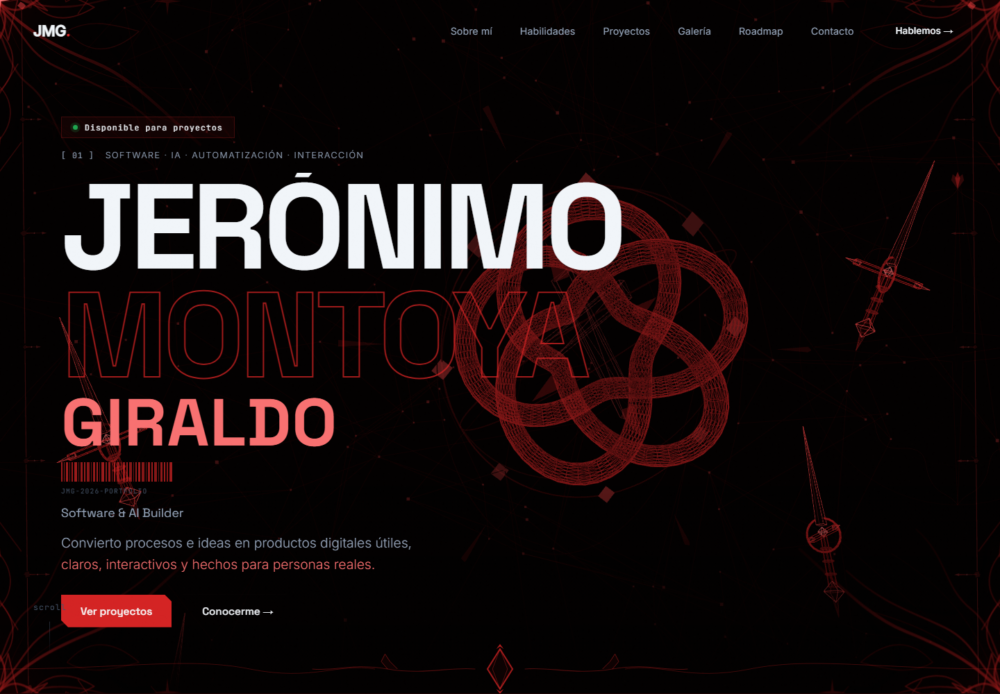

# Jerónimo Montoya — Portfolio

Personal portfolio for Jerónimo Montoya, a software and applied AI builder based in Medellín, Colombia. It brings together selected work in software, interactive experiences, VR and UX/UI.

## Live site

[skulls562.github.io](https://skulls562.github.io)



## Highlights

- Responsive single-page experience with progressive enhancement.
- Interactive motion and 3D details with reduced-motion support.
- Project work presented with honest status labels and real source material.
- No trackers, advertising scripts or exposed personal email address.

## Run locally

The site is static. Serve the repository with any local HTTP server:

```bash
npx serve .
```

Then open the URL printed by the server.

## License

[MIT](LICENSE). Project images and personal photography remain the property of their respective authors and are included for portfolio presentation.

